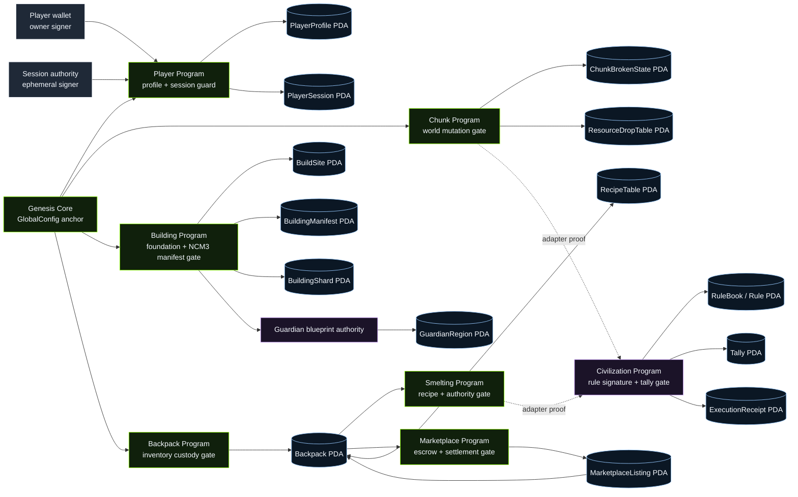

# NiceChunk Contracts


Focused contract repository for the current NiceChunk Solana surface.

This split contains the Rust native programs, TypeScript SDK helpers, contract operation scripts, focused tests, runtime rule data, public chain configuration, and the browser contract directory that explains the active PDA and instruction surface.

## Official Links

GitHub: [https://github.com/nicechunk/nicechunk-contracts](https://github.com/nicechunk/nicechunk-contracts)

Website: [https://nicechunk.com/contracts/](https://nicechunk.com/contracts/)

## Current Scope

The workspace currently includes these Solana programs:

| Program | Role |
| --- | --- |
| `nicechunk_core` | Global configuration, authority seeds, and shared on-chain constants. |
| `nicechunk_player` | Player profiles, session authority, identity, appearance, and profile state. |
| `nicechunk_chunk` | Chunk state, generated block verification, broken block records, resource drop tables, and surface decoration tables. |
| `nicechunk_game` | Game routing layer for shared program integration. |
| `nicechunk_guardian` | Guardian registry, endpoint operations, proof state, operator rotation, and blueprint metadata. |
| `nicechunk_backpack` | Backpack and inventory records used by gameplay and item custody flows. |
| `nicechunk_market` | Marketplace listing state and listing lifecycle instructions. |
| `nicechunk_smelting` | Smelting recipe tables, rule synchronization, and recipe retirement tests. |
| `nicechunk_civilization` | Civilization rule books, signatures, tallies, execution receipts, value snapshots, and citizen power. |
| `nicechunk_building` | Player build sites, NCM3 building manifests, upload shards, resize flow, legacy migration, and Guardian blueprint publishing. |

## Contract Logic Map

The contract surface is easiest to read as a set of trust boundaries and evidence accounts rather than a linear transaction list:



The hosted contract directory expands this map into the visual `Contract Logic Atlas`, with account layouts, PDA seeds, source panels, and RPC decoders for the active devnet surface.

## Building Program

`nicechunk_building` is part of the active devnet contract surface. It validates player sessions, creates and resizes foundation build sites, registers occupied chunks through the chunk authority PDA, stages NCM3 payload shards, finalizes building manifests after hash and fit checks, and publishes Guardian blueprint summaries through a program-derived authority.

Important account groups:

| Account | Seeds | Size |
| --- | --- | --- |
| `BuildSite` | `["build-site-v1", globalConfig, foundationId:u64_le]` | 160 bytes, with 136-byte legacy decode support |
| `BuildingManifest` | `["building-v2", globalConfig, foundationId:u64_le, revision:u32_le]` | 160 bytes |
| `BuildingShard` | `["building-data-v1", globalConfig, foundationId:u64_le, revision:u32_le, shardIndex:u8]` | 64-byte header plus payload, up to 8,256 bytes |
| `GuardianBlueprintAuthority` | `["guardian-blueprint", globalConfig]` | PDA signer only |

The browser decoder in `contracts/contracts.js` can inspect `BuildSite`, `BuildingManifest`, and `BuildingShard` accounts from RPC alongside the other known PDA groups.

## Repository Layout

| Path | Purpose |
| --- | --- |
| `Cargo.toml` / `Cargo.lock` | Rust workspace for the included Solana programs. |
| `programs/` | On-chain Rust program source. |
| `sdk/` | TypeScript helpers for deriving accounts and building instructions. |
| `scripts/` | Contract operation scripts for config, player init, mining, Guardian registry, building blueprints, smelting rules, and civilization settlement. |
| `tests/` | Focused contract and rule tests. |
| `contracts/` | Browser contract directory, account decoders, source panels, and localized copy. |
| `public/mainnet.json` | Runtime chain configuration consumed by the contract directory and client surfaces. |
| `public/contracts/locales/` | Built locale payloads for the hosted contract directory. |
| `public/rules/smelting-rules.json` | Current smelting rule payload mirrored into the contract split. |
| `civilization/` and `chunk.js/` | Runtime rule helpers needed by contract tests and synchronization scripts. |

## Public Chain Configuration

`public/mainnet.json` is the current runtime configuration snapshot used by NiceChunk web surfaces. The contract directory reads it to show the configured cluster, RPC settings, token addresses, and program IDs. The file currently includes the Building program ID:

```text
39UMTUWXQkuomkFNbDPF5NGZnJmG6pDkJHVSkZyqVwWx
```

Keep this file synchronized whenever deployed program IDs, token accounts, or public RPC defaults change.

## Contract Directory

The `contracts/` page imports real Rust and SDK source files with Vite raw imports. It is intended to be a practical source browser for frontend developers, auditors, and contributors:

- Program panels show role, status, program ID, instruction list, PDA seeds, account layouts, and notes.
- Source tabs link each program to `Cargo.toml`, `lib.rs`, `state.rs`, errors, cluster config, and SDK files where available.
- The RPC browser decodes known PDA layouts, including player sessions, chunk state, resource tables, Guardian regions, backpacks, smelting recipes, market listings, civilization records, and building records.

## Validation

Install the exact dependency graph:

```bash
npm ci
```

Run the local release-equivalent gate:

```bash
npm run validate:release
```

`validate:release` runs dependency audit, license audit, focused TypeScript contract tests, and the production Vite build for the contract directory.

When a Rust toolchain is available, also check the workspace:

```bash
cargo check --workspace
```

Some operation scripts require real Solana RPC, wallet, mint, or treasury configuration. Do not commit private keys, wallet files, `.env` files, deployment-only machine config, or generated build artifacts.

## Maintenance Notes

This repository is generated as a focused split from the main NiceChunk working tree. Changes should stay aligned with the real program source, SDK helpers, public configuration, rule data, and contract directory copy. When a program ID, account layout, PDA seed, instruction discriminator, or SDK helper changes, update the matching Rust source, SDK file, browser decoder, locale text, and focused tests together.
