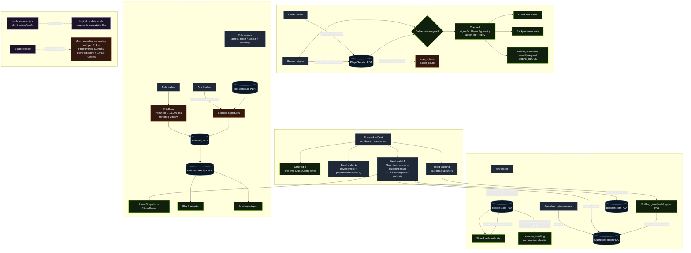

# NiceChunk Contracts

Focused contract repository for the current NiceChunk Solana surface.

This split contains the Rust native programs, TypeScript SDK helpers, contract operation scripts, focused tests, runtime rule data, public chain configuration, and the browser contract directory that explains the active PDA and instruction surface.

## Official Links

GitHub: [https://github.com/nicechunk/nicechunk-contracts](https://github.com/nicechunk/nicechunk-contracts)

Website: [https://nicechunk.com/contracts/](https://nicechunk.com/contracts/)

## Current Scope

The workspace currently includes these Solana programs:

| Program | Role |
| --- | --- |
| `nicechunk_core` | Global configuration, authority seeds, and shared on-chain constants. |
| `nicechunk_player` | Player profiles, session authority, identity, appearance, and profile state. |
| `nicechunk_chunk` | Chunk state, generated block verification, broken block records, resource drop tables, and surface decoration tables. |
| `nicechunk_game` | Game routing layer for shared program integration. |
| `nicechunk_guardian` | Guardian registry, endpoint operations, operator rotation, blueprint metadata, and legacy proof fields whose instruction paths are retired. |
| `nicechunk_backpack` | Backpack and inventory records used by gameplay and item custody flows. |
| `nicechunk_market` | Marketplace listing state and listing lifecycle instructions. |
| `nicechunk_smelting` | Smelting recipe tables, rule synchronization, and recipe retirement tests. |
| `nicechunk_civilization` | Civilization rule books, signatures, tallies, execution receipts, value snapshots, and citizen power. |
| `nicechunk_building` | Player build sites, NCM3 building manifests, upload shards, resize flow, legacy migration, and Guardian blueprint publishing. |

## Contract Logic Map

The contract surface is easiest to read as a set of trust boundaries and evidence accounts rather than a linear transaction list:


The hosted contract directory expands this map into the visual `Contract Logic Atlas`, with account layouts, PDA seeds, source panels, and RPC decoders for the source and client-configured devnet surface. Client configuration is not deployment evidence.

## Reviewer Audit Matrix

External review should tie each contract claim to an authority gate, a public evidence account, and a current runtime boundary:

| Surface | Authority gate | Public evidence | Current boundary |
| --- | --- | --- | --- |
| Genesis Core | `GlobalConfig` is initialized from generated genesis constants and then read by clients. | World seed, config hashes, NCK mint, chunk dimensions, Guardian parameters. | Core does not mint items, mutate terrain, update inventory, or execute governance. |
| Player Identity | Owner wallet controls profile state; an expiry-bearing session signer may submit action-mask-approved calls. | `PlayerProfile`, `PlayerSession`, appearance, and equipment PDA records. | Consumers do not enforce the stored action counter or a maximum duration, and no revoke/close path exists. Browser-cached addresses are not proof of control. |
| Chunk / Mining | Chunk logic recomputes the generated block from `GlobalConfig` and rejects invalid or already broken targets. | `ChunkBrokenState`, `ResourceDropTable`, surface decoration table, packed local block records. | The program stores sparse mutations, not full terrain; inventory settlement is separate. |
| Building | Valid `PlayerSession` and matching `PlayerProfile` gate BuildSite changes, upload shards, resize, and finalization. | `BuildSite`, `BuildingManifest`, `BuildingShard`, chunk authority PDA, Guardian blueprint authority PDA. | A manifest only becomes active after shard completeness, hash, and fit checks pass. |
| Guardian Registry | The fixed treasury initializes registry state and rotates operators; the current operator updates endpoints; Building's scoped PDA updates blueprint metadata. | `GuardianRegistry` and `GuardianRegion` owner, operator, endpoint, stake, legacy proof, and blueprint fields. | Proof/settlement tags are retired, stored counters do not prove liveness, and no stake exit, refund, reclaim, or slash path is live. |
| Backpack Inventory | Owner and authorized program signers control slot creation, removal, and delivery; direct tag `2` also accepts a `BREAK_BLOCK` session. | `Backpack` item count, fixed slot payloads, coordinates, material or item identity, durability. | The session removal branch can target any selected slot type; Smelting and Marketplace use separate explicit authority paths. |
| Smelting Recipes | Any signer may first-initialize an unused table ID and become its authority; smelting authority mutates Backpack slots after selected-table validation. | `RecipeTable`, stored authority, recipe IDs, heat tiers, input/output volumes, disabled recipe flags. | Execution accepts any Smelting-owned table and has no canonical-table allowlist; verify table provenance independently. |
| Marketplace | Seller signatures and market authority gate escrow, cancel, settlement, and delivery. | `MarketplaceListing`, seller, buyer, currency, price, escrowed slot bytes, settlement state. | The listing PDA is the custody record; it does not prove a private orderbook. |
| Civilization Rules | Rule targets, citizen signatures, power snapshots, caller-supplied tallies, and receipts are separate records. | `RuleBook`, `RuleSignature`, `RuleTally`, `ExecutionReceipt`, `PowerSnapshot`, `CitizenPower`. | `mainnet.json` omits Civilization, but that is not an on-chain disable switch. No voting window is enforced, threshold may be 1 bps, and the finalizer can omit available signatures. |

## PDA Seed Evidence

The contract directory now includes a `PDA Seed Evidence` graph built from the Rust and SDK seed constants. The most review-sensitive seeds are:

| Evidence family | Seeds | Why it matters |
| --- | --- | --- |
| World anchor | `GlobalConfig`: `["global-config"]` | Every world proof, chunk write, rule table, and client runtime check should point back to the same public configuration anchor. |
| Chunk deltas | `ChunkBrokenState`: `["chunk-broken", globalConfig, chunkX:i32_le, chunkZ:i32_le]`; `FoundationChunk`: `["foundation-chunk", globalConfig, chunkX:i32_le, chunkZ:i32_le]` | Mining records and foundation occupancy remain sparse, chunk-scoped evidence rather than a private terrain database. |
| Rule tables | `ResourceDropTable`: `["resource-drops-v2", globalConfig]`; `SurfaceDecorationTable`: `["surface-decor-v1", globalConfig]` | The active resource-drop seed is `resource-drops-v2`; it is scoped by `GlobalConfig` and does not include a table ID. |
| Identity and inventory | `PlayerProfile`: `["player-v7", owner]`; `PlayerSession`: `["session", owner, sessionAuthority]`; `Backpack`: `["backpack", creator, backpackId:u64_le]` | Ownership, expiry-bearing action authority, and item custody are separate PDA families; the seed does not enforce duration or action count. |
| Program signer boundaries | `ChunkAuthority`: `["chunk-authority-v1", globalConfig]`; `GuardianBlueprintAuthority`: `["guardian-blueprint", globalConfig]`; `SmeltingAuthority`: `["smelting-authority"]`; `MarketplaceAuthority`: `["market-authority"]` | These named CPI routes re-derive and validate explicit PDA signers. Other CPI branches use an owner signer or a different scoped authority, so the listed seeds are not a universal signer rule. |
| Building publication | `BuildSite`: `["build-site-v1", globalConfig, foundationId:u64_le]`; `BuildingManifest`: `["building-v2", globalConfig, foundationId:u64_le, revision:u32_le]`; `BuildingShard`: `["building-data-v1", globalConfig, foundationId:u64_le, revision:u32_le, shardIndex:u8]` | A visible building is tied to a validated footprint, manifest hash, shard bitmap, and revision. |
| Governance proof | `RuleBook`, `RuleSignature`, `RuleTally`, `ExecutionReceipt`, `PowerSnapshot`, and `CitizenPower` seeds | Civilization evidence stays independently decodable, but a receipt does not prove every available signature was counted or that a voting window elapsed. |

## Instruction Surface Map

The contract directory now includes an `Instruction Surface Map` generated from the current Rust `process_instruction` dispatchers. It is meant to catch stale SDK assumptions, especially retired or intentionally disabled discriminators.

| Program | Accepted tags | Disabled or unassigned tags | Audit note |
| --- | --- | --- | --- |
| `nicechunk_game` | Wire payload `[namespace, childTag, childPayload...]`; namespaces `1` Backpack, `2` Chunk, `3` Smelting, `4` Market | Empty payload or any namespace outside `1-4` | The router passes its incoming Game program ID into the child processor, so unified-route PDA derivation is governed by the Game ID. Current client configuration aliases Backpack, Market, and Smelting to Game while Chunk remains standalone; routing configuration is not deployment proof. |
| `nicechunk_core` | Exact payload `[0]` for `initialize_global_config` | Any other payload | Core is a one-time genesis anchor, not a general admin router. |
| `nicechunk_player` | `0-15` | Any tag above `15` | Identity, session authority, appearance, invite indexes, equipment, transfer, swap, and durability paths are all explicit branches. |
| `nicechunk_chunk` | `5`, `6`, `7`, `8`, `9`, `10`, `11`, `12`, `13`, `15`, `20`, `21` | Legacy `0-4` are not accepted | Current world writes center on generated mining checks, rule tables, Civilization receipts, and Building chunk registration. |
| `nicechunk_building` | `0-8` | Any tag above `8` | BuildSite lifecycle, NCM3 shard upload/finalization, legacy migration, resize, and Guardian blueprint publishing are covered. |
| `nicechunk_guardian` | `0`, `1`, `2`, `5`, `6`, `8` | Retired `3` and `4` are rejected | `submit_guardian_proof` and `settle_guardian` are not live dispatcher entries in the current program. |
| `nicechunk_backpack` | `0-6`, `8-11` | `7` returns `UnverifiedForgeInstructionDisabled` | Inventory custody has owner, session, and program-signer branches; tag `8` does not consume fixed-issuer `BlueprintItem` evidence. |
| `nicechunk_smelting` | `0-4` | Any tag above `4` | Recipe authority, execution, authority transfer, and Civilization recipe receipt application are all present. |
| `nicechunk_market` | `0`, `1`, `2` | `3` is an invalid legacy `initialize_asset` path | Listings escrow the full Backpack slot snapshot; user payload does not mint arbitrary item fields. |
| `nicechunk_civilization` | `0-5` | Any tag above `5` | The dispatcher is live source code; omission from `mainnet.json` describes current client routing, not an on-chain disable control. |

## CPI Authority Ledger

The hosted contract directory also includes a `CPI Authority Ledger` for game-facing cross-program writes. It traces the current Rust `invoke` and `invoke_signed` sites by caller branch, callee tag, signer PDA, and durable evidence account.

| Caller branch | Callee tag | Signer boundary | Durable evidence |
| --- | --- | --- | --- |
| `nicechunk_building` tag `1` `register_build_site_chunks` | `nicechunk_chunk` tag `15` `register_build_site_chunk` | `ChunkAuthority`: `["chunk-authority-v1", globalConfig]` derived under the Building program and re-derived by Chunk | `FoundationChunk` PDA stores chunk-scoped foundation occupancy. |
| `nicechunk_building` tag `8` `publish_guardian_blueprint` | `nicechunk_guardian` tag `6` `update_guardian_blueprint` | `GuardianBlueprintAuthority`: `["guardian-blueprint", globalConfig]` | `GuardianRegion` blueprint hash, revision, and record count. |
| `nicechunk_chunk` reward-bearing mining tags `8`, `9`, `20`, `21` | `nicechunk_backpack` tags `1` and `6` | `ChunkBrokenState` PDA signs mined-resource delivery for the exact chunk coordinates | Backpack v3 resource slots with block coordinates, volume, and metadata. Chunk tag `5` records a mined block but does not perform the Backpack reward CPI. |
| `nicechunk_player` tag `13` `transfer_equipment_slot` | `nicechunk_backpack` tags `10` and `11` | `EquipmentTransferAuthority`: `["equipment-transfer-v1"]` under the Player program | `PlayerEquipment` and Backpack slots stay synchronized without arbitrary item minting. |
| `nicechunk_smelting` tag `2` `execute_smelting` | `nicechunk_backpack` tags `4` and `5` | Owner signer removes inputs; `SmeltingAuthority`: `["smelting-authority"]` appends validated outputs | Backpack slots and `RecipeTable` records show recipe IO and output identity. |
| `nicechunk_market` tags `0`, `1`, `2` | `nicechunk_backpack` tags `2` and `3`; `nicechunk_player` tag `2` when clearing display equipment | Seller signer removes or clears; `MarketAuthority`: `["market-authority"]` restores or delivers the slot snapshot | `MarketplaceListing` stores seller, buyer, currency, price, lifecycle timestamps/state, and the full 80-byte source slot. The fee is computed during purchase and is not stored as listing fee state. |
| `nicechunk_chunk` tags `10` and `13`; `nicechunk_smelting` tag `4` | `nicechunk_civilization` tag `3` `execute_rule_receipt` | `CivilizationAdapterAuthority`: `["civilization-adapter", ruleBook]` derived under the target program ID | `ExecutionReceipt` PDA proves target-bound rule execution before target rule state mutates. |

## Account Lifecycle Map

The contract directory now includes an `Account Lifecycle Map` for PDA creation, growth, migration, closure, refund, and sold-state retention. Reviewers should treat account lifecycle as a separate audit surface from instruction dispatch.

| Lifecycle surface | Current behavior | Reviewer check |
| --- | --- | --- |
| PDA creation and selected pre-funded adoption | Core GlobalConfig; Guardian registry/region; Player profile, session, appearance, equipment, and index; ChunkBroken, Chunk PlayerProgress, and FoundationChunk helpers; and Smelting PlayerProgress include paths that can top up a system-owned, zero-data PDA and then `allocate` and `assign` it. Other initializers, including current Market listings, Backpack accounts, Building fixed PDAs, Civilization accounts, Chunk rule tables, and Smelting recipe tables, call `create_account` and do not provide that universal adoption path. | Check the exact initializer before pre-funding. Verify system ownership and zero data where adoption is supported; otherwise pass a fresh PDA and confirm the program-specific creation rule. |
| ChunkBroken growth | `ChunkBrokenState` grows by capacity after rent top-up and `realloc`, with max-capacity checks. | Confirm the record count never exceeds capacity and the account remains rent-exempt at the larger length. |
| FoundationChunk migration | Legacy FoundationChunk records are decoded, converted to v2 records, optionally filtered by a replacement, and re-packed after `realloc`. | Confirm old occupancy evidence survives v1 to v2 migration and replacement only removes superseded records. |
| Player layout upgrade | Player profile, equipment, and appearance accounts can be topped up and reallocated to current lengths. | Compare current account length and owner before trusting decoded profile, equipment, or appearance fields. |
| Building legacy migration and resize | Legacy 136-byte BuildSites are decoded from the Chunk-owned PDA and re-packed into Building-owned BuildSite v2; resize stores staged dimensions and waits for chunk indexing. | Confirm owner, GlobalConfig, foundation ID, footprint, active/pending revision, and registered chunk counters. |
| Building upload cancellation | Canceling an upload closes program-owned shard accounts and the manifest, returning lamports to the session authority. | Treat canceled upload artifacts as closed transient accounts, not durable building state. |
| PlayerAppearance close | `close_player_appearance` is treasury-authority gated, zeroes data, and returns lamports to the treasury authority recipient. | Confirm the recipient is the treasury authority signer before considering the close valid. |
| Marketplace terminal states | Cancel restores the escrowed Backpack slot, zeroes listing data, and refunds listing lamports to the seller; purchase marks the Listing sold and keeps it as settlement evidence. | Distinguish canceled-and-closed listings from sold listings that intentionally remain decodable. |

## Payload Truth Boundary

The contract directory now includes a `Payload Truth Boundary` map for the user-supplied byte payloads that auditors are most likely to misread as durable facts. Treat payloads as selectors or intent until the matching PDA, hash, recipe, slot, signature, tally, or receipt evidence is re-derived by the program.

| Surface | User-supplied payload | Contract-derived truth | Reviewer check |
| --- | --- | --- | --- |
| Marketplace listing | `CreateListingArgs` is exactly 19 bytes: listing ID, currency, source type, source index, and price. | Market validates owner/profile PDAs, reads the Backpack v3 80-byte source slot, and stores the full slot snapshot inside `MarketplaceListing`. | Do not accept item category, volume, durability, grade, level, or item identity from listing payload copy; compare `source_slot` with Backpack slot rules. |
| Building NCM3 upload | `BeginBuildingArgs` declares expected hash, payload length, revision, rotation, and offsets; shard writes are capped at 700 bytes each. | Finalization requires complete shard PDAs, recomputes `hash_payload_slices`, parses NCM3 dimensions, enforces 256-axis and 4,096-command caps, and checks BuildSite fit. | A visible building is only proven by finalized manifest and BuildSite revision state, not by uploaded bytes alone. |
| Smelting execution | Owner supplies recipe ID, input indexes, fuel indexes, and optional multiplier. | A caller-selected, Smelting-owned `RecipeTable` defines enabled recipe IO and yield; Backpack slots are owner-validated before removal; outputs are appended through SmeltingAuthority. | Verify table ID and stored authority separately: the program does not enforce a canonical table or authority. Then verify slots, volume, yield, disabled recipes, and output evidence. |
| Civilization rules | `PublishRuleBookArgs` stores hash commitments, target program/PDA, threshold, target status, and risk; signatures submit side, power, and snapshot hash. | Rule signatures bind citizen power and snapshot hash; tally rejects duplicate signers and impossible power; execution requires a threshold-met caller-supplied subset and adapter authority where needed. | Reconstruct omitted signatures, note the absent voting window and 1 bps floor, and verify that only Chunk or Smelting implements the target adapter before treating a rule as executable. |
| Player identity and equipment | Names, appearance code, title, equipment slot, and equipment model bytes are human-facing input. | Names are canonicalized into `UsernameIndex`; appearance/model code lengths are bounded; equipment model code is tied to verified Backpack records. | Compare signer, PDA seed, stored hash, model-code limits, and embedded Backpack slot identity. |
| Guardian endpoint and blueprint | Endpoint payload carries host, port, TLS flag; blueprint payload carries region, hash, revision, and record count. | Endpoint updates require the region operator; blueprint updates require the Building-derived `guardian-blueprint` PDA authority. | Verify host bounds, port nonzero, role authority, region PDA, blueprint revision monotonicity, and decoded `GuardianRegion`. |

## Value Settlement Map

The contract directory now includes a `Value Settlement Map` for SOL, NCK, rent funding, refunds, stake deposits, and non-payment state changes. This keeps money movement separate from inventory custody and governance evidence.

| Surface | Value movement | Contract gate | Reviewer check |
| --- | --- | --- | --- |
| Marketplace SOL purchases | Buyer signs SOL transfers to the seller and `MARKET_TREASURY`; the fee is `MARKET_FEE_BPS = 100` over `10,000` bps. | `purchase_listing` validates listing state, seller PDA, treasury address, source slot snapshot, and system program. | Recompute `split_market_payment`, confirm seller proceeds, treasury fee, buyer Backpack delivery, and `ListingAccount::mark_sold`. |
| Marketplace NCK purchases | Buyer NCK token transfers are split between seller and treasury through SPL Token `transfer_checked`. | Token accounts must be SPL Token owned, pinned to `NCK_MINT`, and owned by buyer, seller, or `MARKET_TREASURY` as appropriate. | Confirm mint, decimals, token owners, checked transfer amounts, and sold listing evidence. |
| Guardian registration stake | Registration transfers `GUARDIAN_STAKE_AMOUNT = 100,000,000,000` NCK units from operator token account to the treasury PDA token account. | Registry initialization pins `GUARDIAN_TREASURY_WALLET`, `guardian-treasury` PDA, treasury token, NCK mint, and SPL Token program. | Verify operator signer, treasury token owner, adjacency rule, region PDA, and stake transfer. V2 has no deregistration, withdrawal, refund, reclaim, or slash instruction. |
| Rent funding and refunds | Payers fund PDA rent via `create_account`, top-up transfers, or realloc funding; only explicit close paths refund lamports. | Rent is computed from `Rent::minimum_balance(len)` and scoped to the target PDA size. | Distinguish rent from revenue; verify cancel/refund recipients for listing cancel, building upload cancel, and PlayerAppearance close. |
| Non-payment state writes | Mining, smelting, equipment transfer, building proof, and Civilization rule evidence mutate PDA state without moving SOL or NCK. | Program signer PDAs authorize cross-program writes and custody changes. | Classify a path as value movement only when it invokes system transfer, account close/refund, rent funding, or SPL Token `transfer_checked`. |

## Authority & Control Boundary

This map separates checks enforced by the Rust in this checkout from client configuration and external deployment controls. “Source-enforced” below describes the current source only; it is not evidence that a deployed Program account runs the same ELF or that its ProgramData upgrade authority has been closed.



| Boundary | Current source-enforced control | Reviewer consequence |
| --- | --- | --- |
| Core and deployment | Core accepts only initialization tag `0`, writes compiled constants, and exposes no internal admin, pause, or config-update route. Any payer may perform the one-time initialization if the PDA is unused. | Do not call the deployed program immutable from source review alone. Verify the Program account, ELF hash, ProgramData account, and upgrade authority on the target cluster. |
| Player sessions | Owner and session authority sign creation/refresh. Downstream views validate the relevant session-authority/profile identity bindings, the requested action bit, and expiry; Chunk and Building also bind the GlobalConfig. `max_actions` and `action_count` are stored but never enforced or incremented; there is no revoke, close, or maximum-duration path. Building currently asks for `BREAK_BLOCK`, not `PLACE_BLOCK`, on its player-session branches, and Backpack tag `2` accepts a `BREAK_BLOCK` session when removing any selected slot type. | Treat expiry and action mask as the effective limits. Do not describe an action budget, revocation control, placement-specific permission, or resource-only session removal until program logic implements it. |
| Smelting recipes | Any signer can initialize an unused table-ID PDA and becomes its authority; that authority can write recipes or transfer control. Execution accepts any Smelting-owned table containing a matching valid recipe and has no canonical-table allowlist. | A table listed by the client is not uniquely authoritative. Derive its PDA, inspect its stored authority and records, and decide separately which table IDs the protocol intends to trust. |
| Guardian and item roles | Region operators update endpoints; the fixed Guardian treasury rotates operators; approved Building publishers trigger a Building-derived PDA to update Guardian blueprints. The fixed Backpack blueprint issuer applies to tag `9`, while tag `8` does not consume `BlueprintItem` issuer evidence. Guardian proof/settlement tags are retired, and no live stake withdrawal, refund, deregistration, reclaim, or slash path exists. | Keep operator, treasury, publisher, PDA, and item-issuer roles distinct. Do not infer a proof/slash lifecycle or a recoverable registration stake from constants or retired account fields. |
| Civilization | A fixed authority publishes power evidence. A rule author chooses `threshold_bps` from `1` through `10,000`; no voting window is enforced. Any finalizer supplies the signature accounts to count, so reject or challenge signatures can be omitted. Only Chunk and Smelting currently implement target adapters. | Reconstruct the complete signature set independently before accepting a tally, compare omitted sides, and verify the target adapter rather than treating a threshold-met receipt as universal governance execution. |
| Client and repository controls | `public/mainnet.json` supplies client routing/configuration. In the current file, the logical `backpack`, `market`, and `smelting` labels map to one unified executable ID; those labels are not evidence of three independent deployments. This repository currently publishes no GitHub Actions workflow. | Source and config do not prove deployed ELF identity, ProgramData authority, client feature exposure, branch protection, rulesets, required review, or CI enforcement. Collect those facts from chain state, the built client, and GitHub settings for the exact revision. |

The workspace contains ten program crates: the `nicechunk_game` router plus nine domain program crates. None defines a custom `msg!`, `sol_log`, `emit!`, or event structure. Durable accounts, transaction history, CPI traces, and SOL/SPL transfers are therefore the audit evidence; do not describe an application event stream that the current programs do not emit.

## Building Program

`nicechunk_building` is present in source and referenced by the current client devnet configuration; that configuration is not deployment proof. Its current source validates player sessions, creates and resizes foundation build sites, registers occupied chunks through the chunk authority PDA, stages NCM3 payload shards, finalizes building manifests after hash and fit checks, and publishes Guardian blueprint summaries through a program-derived authority.

Important account groups:

| Account | Seeds | Size |
| --- | --- | --- |
| `BuildSite` | `["build-site-v1", globalConfig, foundationId:u64_le]` | 160 bytes, with 136-byte legacy decode support |
| `BuildingManifest` | `["building-v2", globalConfig, foundationId:u64_le, revision:u32_le]` | 160 bytes |
| `BuildingShard` | `["building-data-v1", globalConfig, foundationId:u64_le, revision:u32_le, shardIndex:u8]` | 64-byte header plus payload, up to 8,256 bytes |
| `GuardianBlueprintAuthority` | `["guardian-blueprint", globalConfig]` | PDA signer only |

The browser decoder in `contracts/contracts.js` can inspect `BuildSite`, `BuildingManifest`, and `BuildingShard` accounts from RPC alongside the other known PDA groups.

## Repository Layout

| Path | Purpose |
| --- | --- |
| `Cargo.toml` / `Cargo.lock` | Rust workspace for the included Solana programs. |
| `programs/` | On-chain Rust program source. |
| `sdk/` | TypeScript helpers for deriving accounts and building instructions. |
| `scripts/` | Contract operation scripts for config, player init, mining, Guardian registry, building blueprints, smelting rules, and civilization settlement. |
| `tests/` | Focused contract and rule tests. |
| `contracts/` | Browser contract directory, account decoders, source panels, and localized copy. |
| `public/mainnet.json` | Runtime chain configuration consumed by the contract directory and client surfaces. |
| `public/contracts/locales/` | Built locale payloads for the hosted contract directory. |
| `public/rules/smelting-rules.json` | Current smelting rule payload mirrored into the contract split. |
| `civilization/` and `chunk.js/` | Runtime rule helpers needed by contract tests and synchronization scripts. |

## Public Chain Configuration

`public/mainnet.json` is a client routing and runtime-configuration snapshot used by NiceChunk web surfaces. The contract directory reads it to show the configured cluster, logical program routes, and smelting-table references. It is not an on-chain authorization source, deployment receipt, or proof that an omitted path is disabled. The file currently includes the Building program ID:

```text
39UMTUWXQkuomkFNbDPF5NGZnJmG6pDkJHVSkZyqVwWx
```

The current `chain.programs` map uses one executable ID for the logical `backpack`, `market`, and `smelting` module labels. Review those labels as instruction-routing namespaces for the unified executable, not as proof of three independently deployed programs; standalone crate IDs and conditional program constants in source must be reconciled with the exact built ELF and target-cluster Program accounts.

Keep this file synchronized whenever intended program routes, recipe-table routing, or public runtime defaults change, then verify those claims against chain state and the built client.

## Contract Directory

The `contracts/` page imports real Rust and SDK source files with Vite raw imports. It is intended to be a practical source browser for frontend developers, auditors, and contributors:

- Program panels show role, status, program ID, instruction list, PDA seeds, account layouts, and notes.
- Source tabs link each program to `Cargo.toml`, `lib.rs`, `state.rs`, errors, cluster config, and SDK files where available.
- The RPC browser decodes known PDA layouts, including player sessions, chunk state, resource tables, Guardian regions, backpacks, smelting recipes, market listings, civilization records, and building records. BuildSite discovery routes 160-byte v2 accounts to Building and deployed 136-byte legacy accounts to Chunk.

## Validation

Install the exact dependency graph:

```bash
npm ci
```

Run the local release-equivalent gate:

```bash
npm run validate:release
```

`validate:release` runs dependency audit, license audit, TypeScript typechecking, focused contract tests, and the production Vite build for the contract directory.

When a Rust toolchain is available, also check the workspace:

```bash
cargo check --workspace --locked
cargo test --workspace --locked
```

Some operation scripts require real Solana RPC, wallet, mint, or treasury configuration. Do not commit private keys, wallet files, `.env` files, deployment-only machine config, or generated build artifacts.

## Maintenance Notes

This repository is generated as a focused split from the main NiceChunk working tree. Changes should stay aligned with the real program source, SDK helpers, public configuration, rule data, and contract directory copy. When a program ID, account layout, PDA seed, instruction discriminator, or SDK helper changes, update the matching Rust source, SDK file, browser decoder, locale text, and focused tests together.
